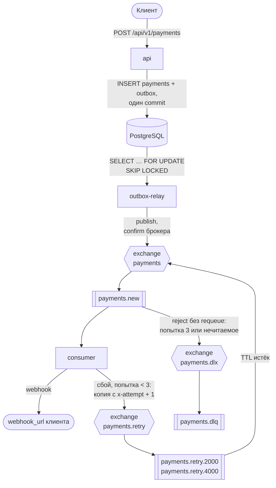
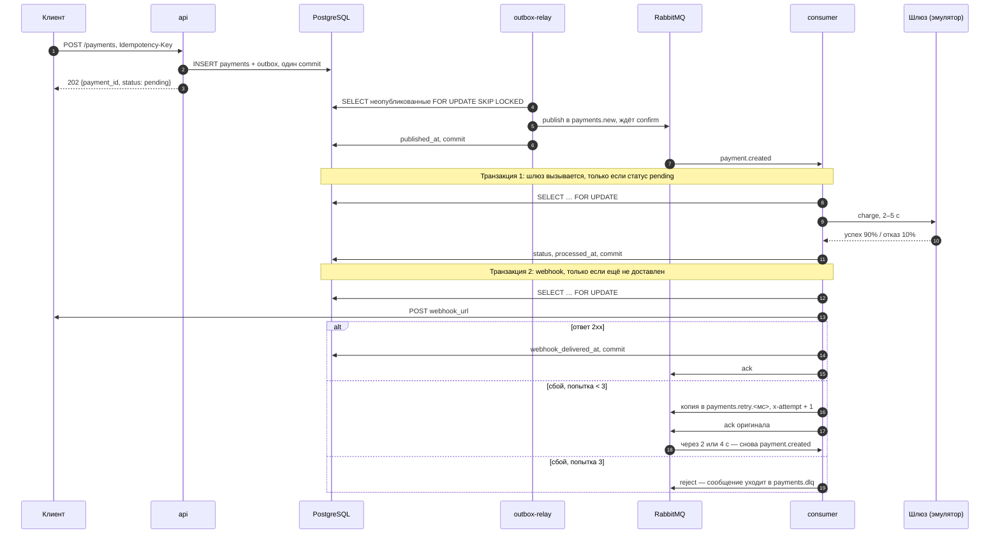

# Асинхронный сервис процессинга платежей

HTTP API принимает платёж и сразу отвечает `202 Accepted`. Дальше платёж
обрабатывается в фоне: consumer RabbitMQ вызывает эмулятор платёжного шлюза
(пауза 2–5 с, 90% успеха), сохраняет статус `succeeded` или `failed` и
отправляет webhook на `webhook_url` клиента. Сбой обработки повторяется с
задержкой, после трёх неудачных попыток сообщение уходит в Dead Letter Queue.

Платёж не теряется, даже если RabbitMQ недоступен в момент запроса: API пишет
событие в таблицу outbox, а в брокер его переносит отдельный процесс.

Стек: FastAPI, Pydantic v2, SQLAlchemy 2.0 (async), PostgreSQL 17, RabbitMQ 4.4
через FastStream, Alembic, Docker Compose.

## Соответствие заданию

| Требование                                   | Где реализовано                                                                                                                         |
|----------------------------------------------|-----------------------------------------------------------------------------------------------------------------------------------------|
| Таблицы `payments` и `outbox`, миграции      | [`db/models.py`](src/app/db/models.py), [`migrations/versions/0001_…`](migrations/versions/0001_create_payments_and_outbox.py)          |
| `POST` и `GET` платежа, `X-API-Key`          | [`api/payments.py`](src/app/api/payments.py), [`api/deps.py`](src/app/api/deps.py)                                                      |
| Событие в очередь `payments.new`             | [`messaging/topology.py`](src/app/messaging/topology.py)                                                                                |
| Один consumer: шлюз, статус, webhook, повторы | [`consumer/handler.py`](src/app/consumer/handler.py), [`services/processing.py`](src/app/services/processing.py)                       |
| Outbox pattern                               | запись — [`services/payments.py`](src/app/services/payments.py), публикация — [`outbox/relay.py`](src/app/outbox/relay.py)              |
| Idempotency key                              | [`services/payments.py`](src/app/services/payments.py); подробности — в разделе [«Идемпотентность»](#идемпотентность)                     |
| Retry с экспоненциальной задержкой и DLQ     | [`consumer/handler.py`](src/app/consumer/handler.py), [`messaging/topology.py`](src/app/messaging/topology.py); раздел [«Повторы»](#повторы) |
| Docker                                       | [`docker-compose.yml`](docker-compose.yml): `postgres`, `rabbitmq`, `api`, `consumer` и три вспомогательных сервиса                     |

Два места, которые задание допускает читать по-разному:

- **«3 попытки» — всего три обработки:** первая и два повтора с задержками
  2 с и 4 с. После третьей неудачи сообщение уходит в DLQ.
- **Отказ шлюза (10%) — не ошибка, а итог платежа:** статус `failed` и
  webhook клиенту, без повторов. Повторяется сбой обработки — недоставленный
  webhook или ошибка БД; шлюз при повторе второй раз не вызывается.

## Запуск

Нужен Docker Compose 2.24 или новее. Ручных шагов нет: миграции применяет
сервис `migrate`, очереди объявляют `outbox-relay` и `consumer`.

```bash
docker compose up --build
```

Сервис готов, когда в логе появились строки запуска `api`.

| Что         | Адрес                        | Переменная порта   |
|-------------|------------------------------|--------------------|
| API         | `http://localhost:8000`      | `API_PORT`         |
| Swagger UI  | `http://localhost:8000/docs` | `API_PORT`         |
| UI RabbitMQ | `http://localhost:15672`     | `RABBITMQ_UI_PORT` |

Swagger UI открывается без ключа, запросы из него — с ключом, введённым через
кнопку Authorize. Там же описаны все коды ответов и, в разделе Webhooks, тело
webhook.

Логин и пароль UI RabbitMQ — `payments` / `payments`. Ключ API — `dev-api-key`,
меняется переменной `API_KEY`. Переменные задаются в окружении или в файле
`.env`; образец со всеми настройками и значениями по умолчанию —
`.env.example`.

Остановка с удалением данных: `docker compose down -v`.

## API

Все эндпоинты находятся под `/api/v1` и требуют заголовок `X-API-Key`; без него
или с неверным ключом — `401`.

Тело ошибок `401`, `404` и `409` — `{"detail": "<текст>"}`. У `422` формат
FastAPI: `detail` — список ошибок с полями `loc` (где ошибка), `msg` и `type`.

### `POST /api/v1/payments`

Заголовок `Idempotency-Key` обязателен, 1–255 символов. Тело:

| Поле          | Обязательно | Правило                                                       |
|---------------|-------------|---------------------------------------------------------------|
| `amount`      | да          | больше нуля, не более двух знаков после точки и 18 цифр всего |
| `currency`    | да          | `RUB`, `USD` или `EUR`                                        |
| `webhook_url` | да          | http или https URL, до 2083 символов                          |
| `description` | нет         | до 500 символов                                               |
| `metadata`    | нет         | JSON-объект                                                   |

`amount` лучше передавать строкой: число JSON клиент может округлить как float.
`description` и `metadata` не принимают символ NUL (`\u0000`) и непарные
суррогаты UTF-16, а `metadata` — ещё и `NaN` и бесконечность: PostgreSQL такие
значения не сохранит, поэтому запрос отклоняется с `422`.

Ответы:

- `202` — `{"payment_id": "<uuid>", "status": "pending", "created_at": "<время>"}`.
  Повтор с тем же ключом и тем же телом возвращает тот же `payment_id` и
  текущий статус платежа. Тела сравниваются после нормализации: `"100.5"` и
  `"100.50"`, как и другой порядок ключей, — один и тот же запрос.
- `409` — ключ уже использован с другим телом.
- `422` — невалидное тело или нет `Idempotency-Key`.

### `GET /api/v1/payments/{payment_id}`

`200` с полями `payment_id`, `amount` (строкой, например `"100.50"`),
`currency`, `description`, `metadata`, `status`, `idempotency_key`,
`webhook_url`, `created_at`, `processed_at`, `webhook_delivered_at`.
`404` — платежа нет, `422` — `payment_id` не UUID.

### Webhook

После обработки сервис отправляет `POST` с JSON на `webhook_url`:

```json
{
  "payment_id": "<uuid>",
  "status": "succeeded",
  "amount": "100.50",
  "currency": "RUB",
  "description": "Заказ 1",
  "metadata": {"order_id": 1},
  "processed_at": "<время>"
}
```

Доставленным считается любой ответ `2xx`, редиректы не выполняются.

## Пример

`webhook_url` в примерах указывает на сервис `webhook-mock` из compose: `/ok`
отвечает 200, `/fail` — всегда 500. Адрес `webhook-mock:8080` виден только
внутри сети compose. Если API запущен на другом порту, поправьте `API`.

```bash
API=http://localhost:8000/api/v1
AUTH='X-API-Key: dev-api-key'
JSON='Content-Type: application/json'
BODY='{"amount": "100.50", "currency": "RUB", "description": "Заказ 1", "metadata": {"order_id": 1}, "webhook_url": "http://webhook-mock:8080/ok"}'
```

Создать платёж и запомнить его id:

```bash
RESPONSE=$(curl -s -X POST "$API/payments" -H "$AUTH" -H "$JSON" -H 'Idempotency-Key: demo-1' -d "$BODY")
echo "$RESPONSE"
PAYMENT_ID=$(echo "$RESPONSE" | sed -E 's/.*"payment_id":"([^"]+)".*/\1/')
```

Повтор с тем же ключом вернёт `202` и тот же `payment_id`, а с другим телом —
`409`:

```bash
curl -i -X POST "$API/payments" -H "$AUTH" -H "$JSON" -H 'Idempotency-Key: demo-1' -d "$BODY"
curl -i -X POST "$API/payments" -H "$AUTH" -H "$JSON" -H 'Idempotency-Key: demo-1' \
  -d '{"amount": "999.00", "currency": "RUB", "webhook_url": "http://webhook-mock:8080/ok"}'
```

Через несколько секунд платёж получает итоговый статус (`failed` — в 10% случаев),
заполняются `processed_at` и `webhook_delivered_at`, а полученный webhook виден
в логе `webhook-mock`:

```bash
curl -s "$API/payments/$PAYMENT_ID" -H "$AUTH"
docker compose logs webhook-mock
```

### Повторы и DLQ

Платёж с `webhook_url`, который всегда отвечает 500:

```bash
curl -i -X POST "$API/payments" -H "$AUTH" -H "$JSON" -H 'Idempotency-Key: demo-fail-1' \
  -d '{"amount": "10.00", "currency": "USD", "webhook_url": "http://webhook-mock:8080/fail"}'
```

Через 10–15 секунд (пауза шлюза в первой попытке, затем задержки 2 с и 4 с):

- в логе `webhook-mock` три запроса на `/fail`;
- в логе `consumer` сбои попыток 1 и 2 с исходом `retry` и попытки 3 с
  исходом `dead`;
- в очереди `payments.dlq` одно сообщение с заголовком `x-attempt: 3`. Его
  видно в UI RabbitMQ (Queues → `payments.dlq` → Get messages) или так:

  ```bash
  curl -s -u payments:payments -X POST http://localhost:15672/api/queues/%2F/payments.dlq/get \
    -H "$JSON" -d '{"count": 1, "ackmode": "ack_requeue_true", "encoding": "auto"}'
  ```

Итоговый статус у платежа при этом есть (шлюз вызывается один раз), а
`webhook_delivered_at` пуст.

### Недоступный брокер

```bash
docker compose stop rabbitmq
```

Платёж, созданный в это время, принимается с ответом `202`. После
`docker compose start rabbitmq` `outbox-relay` дождётся брокера и опубликует
событие, и платёж будет обработан.

## Устройство

Почему выбраны именно эти решения и какие варианты отвергнуты, описано в
[журнале решений](docs/decisions.md).

### Схема потока



### Путь одного платежа



### Outbox

API записывает платёж и событие `payment.created` одной транзакцией и с
RabbitMQ не общается. Процесс `outbox-relay` в цикле:

1. выбирает до 50 неопубликованных событий в порядке создания
   (`SELECT … FOR UPDATE SKIP LOCKED`, поэтому экземпляров может быть
   несколько);
2. публикует их в exchange `payments`: сообщение персистентное, `mandatory`,
   с ожиданием подтверждения брокера и таймаутом;
3. помечает `published_at`.

При ошибке публикации подтверждённые события пакета фиксируются, остальные
остаются в таблице. Relay повторяет попытку с нарастающей паузой до 30 с без
ограничения числа попыток. Все публикации в RabbitMQ (relay и повторы
consumer) идут через `ReliablePublisher`.

### Повторы

Три direct-обменника: `payments`, `payments.retry`, `payments.dlx`. Номер
попытки хранится в заголовке `x-attempt`.

- `payments.new` — основная очередь consumer.
- `payments.retry.2000` и `payments.retry.4000` — очереди задержки без
  потребителей. По истечении TTL сообщение возвращается в `payments.new`.
  TTL очереди нельзя изменить после создания, поэтому задержка входит в имя.
- `payments.dlq` — очередь без потребителя. Сообщение, отклонённое из
  `payments.new` (`reject` без requeue), RabbitMQ перекладывает сюда сам.

Топологию при старте объявляют и `outbox-relay`, и `consumer`, поэтому порядок
запуска не важен.

### Идемпотентность

- **API.** Уникальный индекс по `idempotency_key` и
  `INSERT … ON CONFLICT DO NOTHING`: два одновременных запроса с одним ключом
  создают один платёж. Для сравнения тел хранится SHA-256 нормализованного
  запроса (`request_hash`).
- **Consumer.** Каждая доставка берёт строку платежа через
  `SELECT … FOR UPDATE`. Шлюз вызывается только для платежа в статусе
  `pending`, webhook отправляется, только если `webhook_delivered_at` пуст.
  Дубль сообщения, в том числе обрабатываемый одновременно, не вызывает шлюз и
  webhook повторно.
- Статус и отметка о доставке webhook сохраняются в двух отдельных
  транзакциях, поэтому повтор после сбоя webhook не вызывает шлюз заново.

### Сервисы compose

| Сервис         | Назначение                                                    |
|----------------|---------------------------------------------------------------|
| `postgres`     | база платежей и outbox                                        |
| `rabbitmq`     | брокер                                                        |
| `api`          | HTTP API; от `rabbitmq` намеренно не зависит                  |
| `consumer`     | обработка платежей, повторы, DLQ                              |
| `outbox-relay` | перенос событий из outbox в RabbitMQ                          |
| `migrate`      | разовый `alembic upgrade head`, остальные ждут его завершения |
| `webhook-mock` | приёмник webhook'ов для примеров, не часть сервиса            |

Сверх четырёх сервисов из задания добавлены три. `outbox-relay` вынесен в
отдельный процесс (тот же образ, другая команда), чтобы публикация не зависела
от рестартов и числа воркеров API. `migrate` позволяет поднять всё одной
командой. `webhook-mock` (`devtools/webhook_mock.py`) нужен, чтобы примеры,
повторы и DLQ воспроизводились без внешних сервисов.

## Гарантии и их границы

- **Доставка at-least-once** на всём пути: API → outbox → RabbitMQ → consumer.
  Дубли сообщений возможны (relay упал после публикации до коммита; consumer
  упал после обработки до ack; consumer упал между публикацией копии в очередь
  повтора и ack оригинала). Идемпотентный обработчик их гасит.
- **Webhook тоже at-least-once.** Если consumer упал между отправкой webhook и
  записью `webhook_delivered_at`, клиент получит уведомление дважды. Дубль
  отсеивается по `payment_id` в теле.
- **«3 попытки» — это «не меньше трёх».** Счётчик `x-attempt` растёт только на
  обработанных сбоях. Если consumer падает или рвётся соединение, брокер
  доставляет сообщение заново с тем же номером попытки.
- **Без повторов — сразу в DLQ при первой доставке:** нечитаемое сообщение,
  сообщение о несуществующем платеже и сообщение с некорректным `x-attempt`.
  Повторы им не помогут.
- **Повторяется любой ответ не 2xx, включая 4xx.** Одно правило вместо
  классификации кодов; число попыток всё равно ограничено.
- **Шлюз при повторной доставке может быть вызван ещё раз**, если consumer
  упал после вызова шлюза, но до коммита статуса. Для эмулятора это безвредно;
  настоящему шлюзу передавался бы `payment_id` как ключ идемпотентности.
- **Что остаётся в БД после DLQ.** Если не доставлялся webhook — у платежа
  итоговый статус и пустой `webhook_delivered_at`. Если все попытки упёрлись в
  сбой БД — платёж остаётся `pending`. Разбор DLQ не автоматизирован.
- **Событие, которое нельзя опубликовать, блокирует очередь outbox.**
  Например, событие с routing key без привязки: relay публикует в порядке
  создания и повторяет без ограничения числа попыток, поэтому такое событие
  остаётся первым и задерживает все события за ним.
- **`webhook_url` не проверяется на внутренние адреса (SSRF).** Сервис пошлёт
  запрос на любой http/https адрес, доступный из контейнера.
- **Webhook не подписан.** В запросе нет подписи (например, HMAC тела с общим
  секретом), поэтому получатель не может проверить, что webhook отправил
  сервис. Проверить итог можно запросом `GET /api/v1/payments/{payment_id}`.
- **Смена задержек создаёт новые очереди.** Задержка входит в имя очереди
  (`payments.retry.<мс>`), поэтому при изменении настроек старые очереди
  остаются пустыми, а не вызывают ошибку объявления.
- Опубликованные строки outbox не очищаются; `API_KEY` один на весь сервис.

## Разработка

Нужны Python 3.14, [uv](https://docs.astral.sh/uv/) и запущенный Docker: тесты
поднимают настоящие PostgreSQL и RabbitMQ через testcontainers.

```bash
uv sync
uv run pytest
uv run ruff check .
uv run ruff format --check .
uv run mypy src
```

Тесты покрывают идемпотентность API, outbox relay (в том числе `SKIP LOCKED` и
сбои публикации), повторы и DLQ, обработку дублей и сквозной сценарий
API → relay → consumer → webhook.
